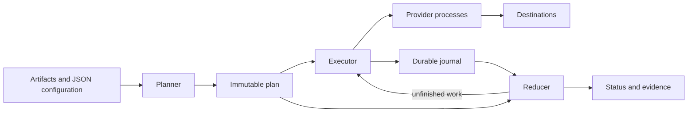

# Architecture

The main CLI prepares the release, tracks progress, and handles recovery. Provider executables do the actual work required by npm, SDKMAN, Homebrew, or WinGet.

## Plan boundary

Planning validates the config and artifacts, invokes provider `describe`/`plan`, checks capabilities and operation dependencies, and records artifact SHA-256 digests, sizes, provider identities, and executable digests. The plan ID hashes semantic intent; core artifact source paths are excluded from that identity, but provider configuration and payload paths are not.

Saved plans retain absolute artifact paths. They are **not portable bundles**. Execution verifies artifact contents and provider binaries against the plan. Provider versions or local binaries cannot be silently replaced for an existing plan.

## Execution and recovery

The executor schedules ready DAG operations with bounded concurrency, attempts, timeouts, and leases. Side-effecting requests have stable plan-derived idempotency keys. Before releasing a request to a provider process, the host durably journals its dispatch boundary. A dispatched operation whose outcome is unknown must be reconciled before another publication attempt.

The append-only journal uses checksummed frames, sequence validation, file synchronization, and an OS writer lock. Journal schema v2 binds `RUN_STARTED` to the plan ID; replay against another plan fails even if operation IDs match. An incomplete final frame is recoverable, but corruption of a complete frame is not. The reducer derives state solely from the saved plan and journal.

`reconcile` observes outstanding side effects and never starts a new publication. An unmet credential prerequisite is `BLOCKED` before dispatch and can resume with the same plan/journal after credentials are supplied. The [CLI guide](cli.md) documents the narrowly scoped, operator-authorized retry for an ambiguous npm publication.

## Provider boundary

Each invocation exchanges one JSON request and response over stdin/stdout. The host enforces protocol size/deadline limits, provider identity and capability checks, executable digest binding, and an allowlisted environment with explicitly mapped credentials. Subprocesses are **not** security sandboxes.

| Protocol operation | Responsibility |
| --- | --- |
| `describe` | Advertise provider identity, versions, and capabilities |
| `plan` | Validate destination configuration and return immutable operations |
| `apply` | Attempt a planned operation |
| `reconcile` | Observe external state without publishing |

Protocol v1 is documented by its [schema](../protocol/schema/v1/protocol.schema.json), [examples](../protocol/examples/v1/messages.json), and [compatibility status](../protocol/schema/v1/compatibility.json). Unknown fields are tolerated where the protocol permits; unsupported versions, operations, and capabilities are rejected.

## Evidence and guarantees

Evidence exports the journal-derived run and operation states, artifact/provider identities, external references, and journal digest. It is not an independent destination query, signature, or attestation. Provider results vary in what they prove; consult each [provider guide](../README.md#providers). There is no daemon, distributed execution service, universal rollback, or exactly-once publication guarantee.
